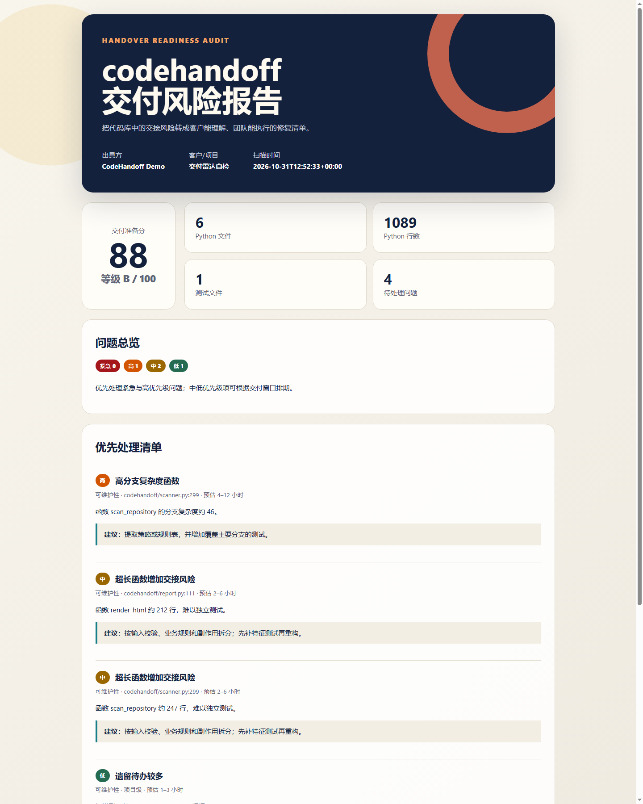

# CodeHandoff / 交付雷达

Local-first Python handover risk reports for independent developers and small
software studios.

CodeHandoff turns vague questions such as "can this inherited project be
delivered safely?" into an evidence-linked report: delivery-readiness score,
high-priority findings, file locations, estimated effort, and a practical
repair order.

> This repository is the public product page and sample-report showcase. The
> production implementation is not included in this repository.

## What you get

- A customer-readable HTML report and machine-readable JSON result.
- Findings linked to concrete files and lines.
- Delivery risks such as missing tests, oversized or high-branch functions,
  risky calls, dependency and CI gaps, documentation gaps, and hard-coded
  secret patterns.
- A prioritized repair list with estimated effort.
- Explicit report boundaries: this is static delivery-risk screening, not a
  security audit or test-coverage measurement.

## Service options

| Option | Starting price | Intended result |
| --- | ---: | --- |
| Standard project report | CNY 99+ | One project, HTML report, JSON result, 30-minute explanation |
| Report and retest | CNY 299+ | Initial report plus a follow-up retest |
| Studio delivery gate | CNY 999+/month | Recurring pre-delivery checks for a small studio |

Final scope, price, delivery date, and refund terms are confirmed in writing
before payment. The starting prices are not revenue claims and do not include
work outside the agreed scope.

## Purchase or request a fit check

Have a public GitHub repository? Send its
`https://github.com/owner/repo` URL for a free read-only sample before deciding
whether the full service is useful.

Visit the live service page:

https://little-mouse-2f95.david56782004.workers.dev/

Do not post private repository contents, credentials, customer data, or
payment details in GitHub issues. Use the public service page for inquiries.

## Sample

- [HTML report](samples/report.html)
- [Markdown report](samples/report.md)
- [JSON result](samples/report.json)

The sample is a self-scan used to demonstrate output format. It is not a
customer case study, certification, or guarantee of future results.

## Scope and limits

- CodeHandoff does not execute the scanned project.
- It does not read `.env` files or credential files.
- It does not claim that a passing score means the project is risk-free.
- It does not replace a security audit, penetration test, legal review, full
  test suite, or architecture review.
- Static heuristics can produce false positives and false negatives.

See [SERVICE.md](SERVICE.md) for the delivery process and
[SECURITY.md](SECURITY.md) for data-handling rules.

